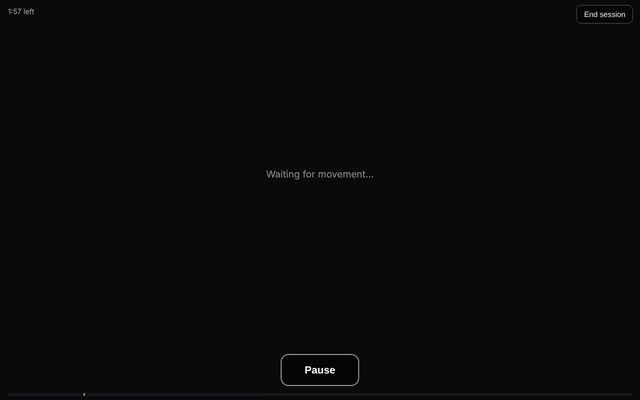

# WigglePlay

Free games built for disabled children to interact with a screen through movement. Any movement in front of the camera brings up simple colour and sound.

**Play:** https://moeghaf.github.io/camera-toy/

*Silent demo of Colours, captured with a simulated camera.*

## Games

| Game | What happens | Play |
| --- | --- | --- |
| **Colours** | Movement fills the screen with slowly blending colour and gentle music | [Open](https://moeghaf.github.io/camera-toy/games/colours/) |

More to come.

## Collaborate

Happy for collaborations! Feel free to [ask for a specific game](https://github.com/moeghaf/camera-toy/issues) to be built for your child.

You could even try vibe coding a game yourself. It is very easy to do:

1. Copy `games/colours/` to a new folder under `games/`.
2. Ask an AI coding assistant to change what happens on movement.
3. Add your game to the list on `index.html` and in this README.

`shared/motion.js` handles the camera and movement detection for every game.

## Gentle and private

- Colour and sound only fade and blend. Nothing flashes.
- The adult sets the limits for brightness, volume and session length.
- Video stays on the device. Nothing is recorded or sent.

These are toys for supervised play, not medical devices.
