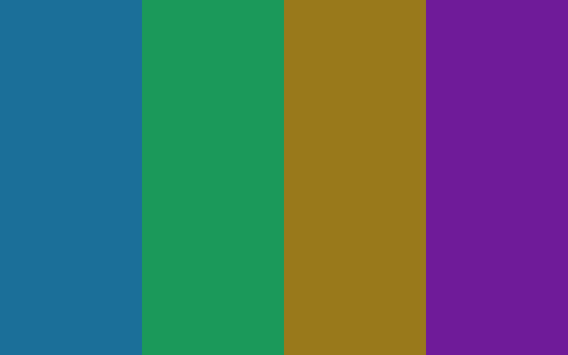
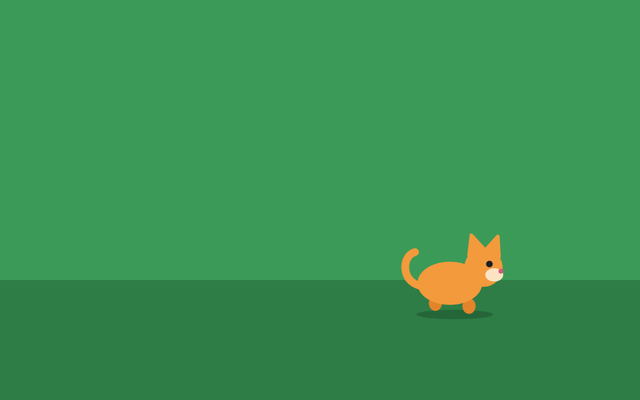
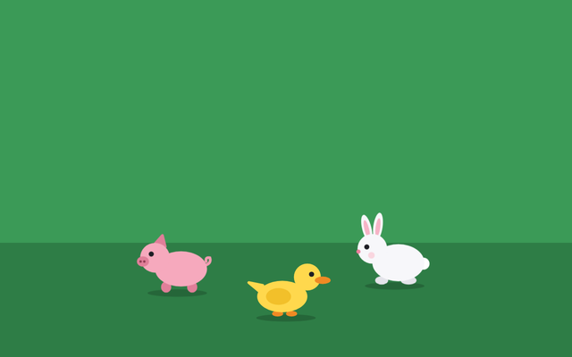
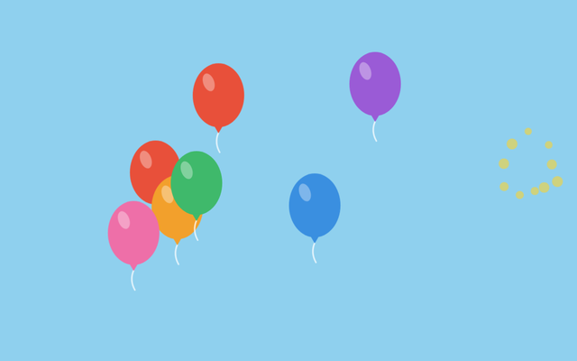
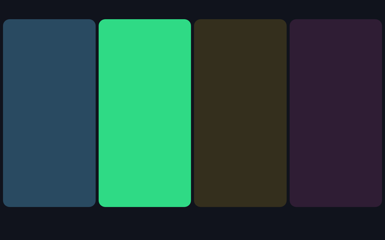

<picture>
  <source media="(prefers-color-scheme: dark)" srcset="assets/logo-dark.png">
  
</picture>

Free games built for disabled children to interact with a screen through movement. Any movement in front of the camera brings up simple colour and sound.

**Play:** https://moeghaf.github.io/camera-toy/

*Silent demo of Musical Colours, captured with a simulated camera.*

## Games

| | Game | What happens |
| --- | --- | --- |
|  | [**Musical Colours**](https://moeghaf.github.io/camera-toy/games/musical-colours/) | Movement fills the screen with slowly blending colour and gentle music |
|  | [**Walking Animals**](https://moeghaf.github.io/camera-toy/games/walking-animals/) | An animal walks towards the side the child looks at, and sleeps when their eyes close |
|  | [**Surprise Friends**](https://moeghaf.github.io/camera-toy/games/surprise-friends/) | Any movement brings a new animal friend onto the screen with its own tune |
|  | [**Balloon Pop**](https://moeghaf.github.io/camera-toy/games/balloon-pop/) | Balloons float up and movement pops them, anywhere or on the side you move |
|  | [**Music Wall**](https://moeghaf.github.io/camera-toy/games/music-wall/) | Movement on one side of the screen lights that pad and plays its note |

More to come.

## Sources

Surprise Friends, Balloon Pop and Music Wall are our own takes on ideas from the free switch-accessible games at [CerebralPalsyCenter.com](https://www.cerebralpalsycenter.com/games/). They are rebuilt with new code, art and sound so they can be played by movement through the camera.

## Collaborate

Want to work on this together? That would be great. Email [moeghaf@gmail.com](mailto:moeghaf@gmail.com) or [open an issue](https://github.com/moeghaf/camera-toy/issues) to say hello, or to ask for a specific game to be built for your child.

You could even try vibe coding a game yourself. It is very easy to do:

1. Copy `games/surprise-friends/` to a new folder under `games/`. It is the shortest game.
2. Ask an AI coding assistant to change what happens on movement.
3. Add your game to the list on `index.html` and in this README.

`shared/kit.js` gives every game its settings screen, camera, timer and sound. `shared/motion.js` detects movement and `shared/face.js` tracks head turns, eye direction and eye closing.

## Gentle and private

- Colour and sound only fade and blend. Nothing flashes.
- The adult sets the limits for brightness, volume and session length.
- Video stays on the device. Nothing is recorded or sent.

These are toys for supervised play, not medical devices.
