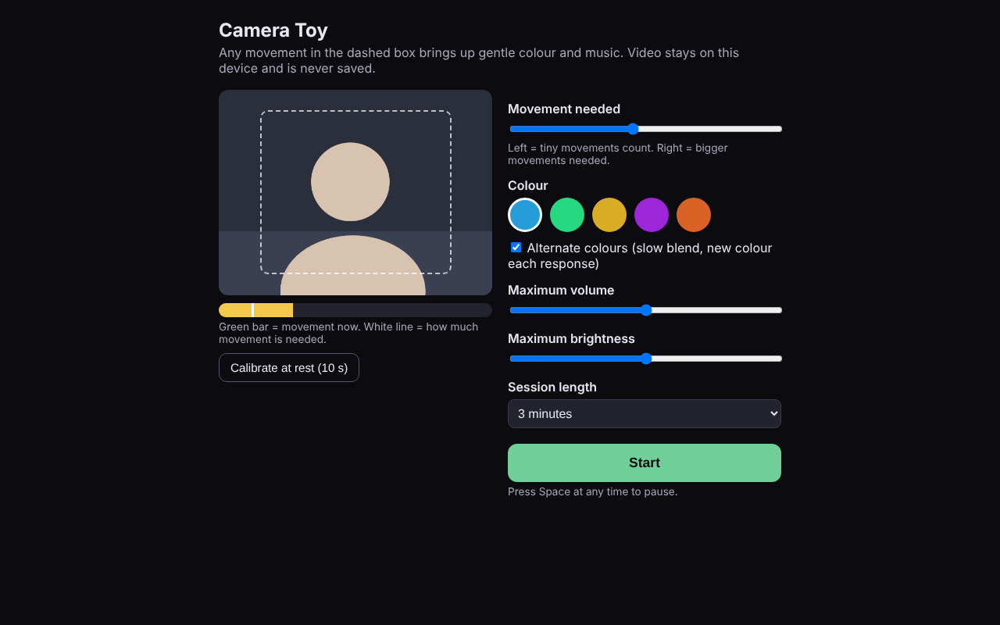
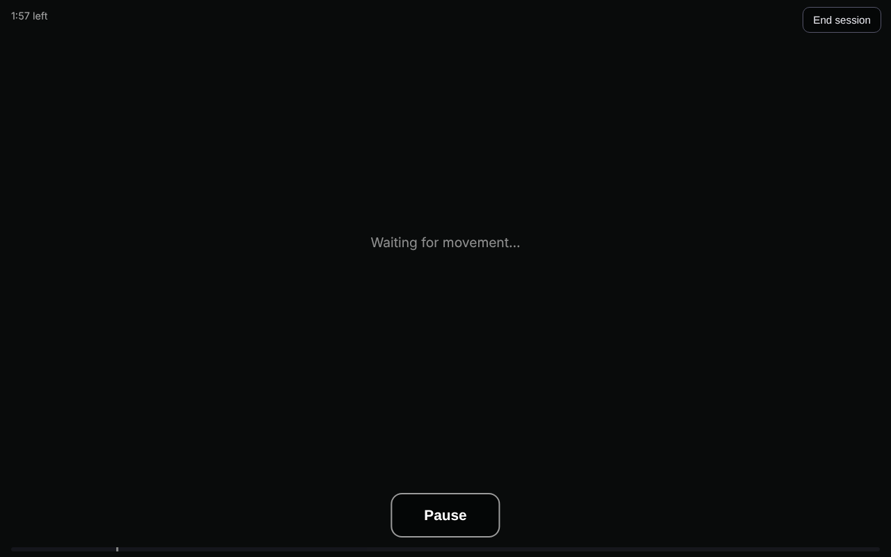
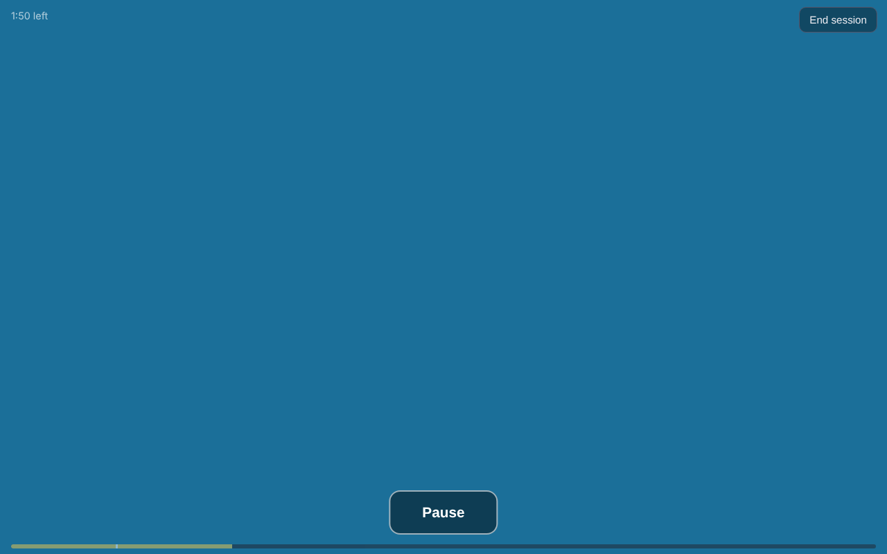

# Camera Toy

A web page built for disabled children to interact with a screen through movement. The camera watches for movement, and the screen answers with simple colour and sound.

**Try it:** https://moeghaf.github.io/camera-toy/

*The demo has no sound. On the real page, gentle music plays whenever the colour is on.*

## Why

Many children with severe physical disabilities cannot use touchscreens, switches or controllers. Camera Toy needs no contact and no particular movement. Any movement the child can make, however small, is enough to make something happen.

That link between "I move" and "the screen responds" is the starting point for later play and communication.

## What it does

- Any movement inside the camera box fades the screen into colour and starts soft music.
- The colour and music carry on while the child keeps moving.
- Colours blend slowly from one to the next.
- About 4 seconds after movement stops, everything fades back out.
- At the end of a session it shows how many responses were triggered and how many seconds of movement there were.

| Settings | Waiting | Responding |
| --- | --- | --- |
|  |  |  |

*Screenshots and demo were captured with a simulated camera feed, not a real person.*

## How to use it

1. Open the link on a laptop, tablet or phone and allow the camera.
2. Place the device on a stand so the child is inside the dashed box.
3. Press **Calibrate at rest** while the child is still. This sets how much movement is needed.
4. Press **Start**. Press **Pause** or the Space key to pause.

On an iPhone, switch silent mode off or there will be no music.

## Settings

| Setting | What it changes |
| --- | --- |
| Movement needed | How big a movement must be to count |
| Colour | The starting colour |
| Alternate colours | Blend through several colours, or keep one |
| Maximum volume | The loudest the music can get |
| Maximum brightness | The brightest the screen can get |
| Session length | 2, 3, 5 or 10 minutes |

## Designed to be gentle

- **No flashing.** Every colour change is a slow fade or blend.
- **No sudden sound.** Music fades in and out.
- **Limits you control.** Brightness, volume and session length are capped by the adult.
- **One-press pause.** Pausing stops the music and dims the screen.

Use it with an adult present. Keep other people and moving objects out of the camera box, because any movement there counts.

## Privacy

Video is analysed in the browser on your own device. It is never recorded, saved or sent anywhere. The page has no accounts, tracking or adverts.

## How it works

The whole toy is one file, `index.html`, with no libraries and nothing to install.

- **Movement:** each camera frame is shrunk to a small greyscale image and compared with the previous frame. The share of pixels that changed is the movement score.
- **Light:** overall brightness is removed before comparing frames, so the glow of the screen does not count as movement.
- **Sound:** the music is generated in the browser, so there are no audio files.

To run your own copy, fork this repository and turn on GitHub Pages, or serve `index.html` from any https address. Browsers only allow camera access on https or localhost.

## Limits

- It detects any movement in the box. It cannot yet tell a head turn from a hand wave.
- Changing room light, or a bright window behind the child, can trigger it.
- Nothing is saved between sessions.
- It is a toy, not a medical device. It does not assess, diagnose or monitor anything.

## Planned

- Specific movements such as head turns and mouth opening, each with its own sound
- A session log to show change over time
- Favourite songs and family voices as rewards
- The same software driving real lights and switch-adapted toys
