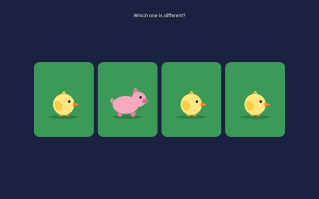
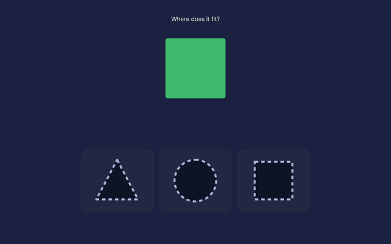
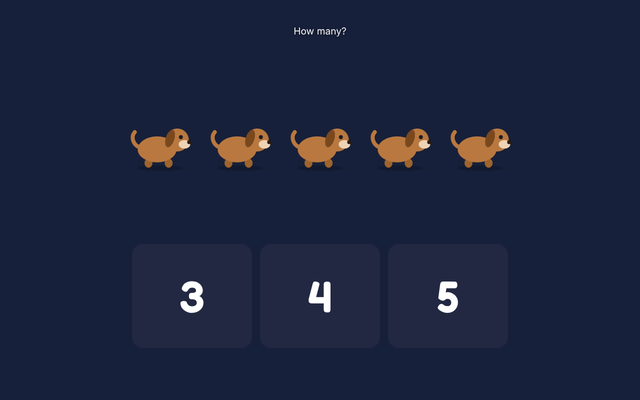
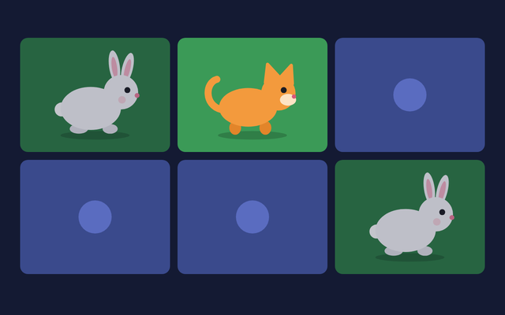
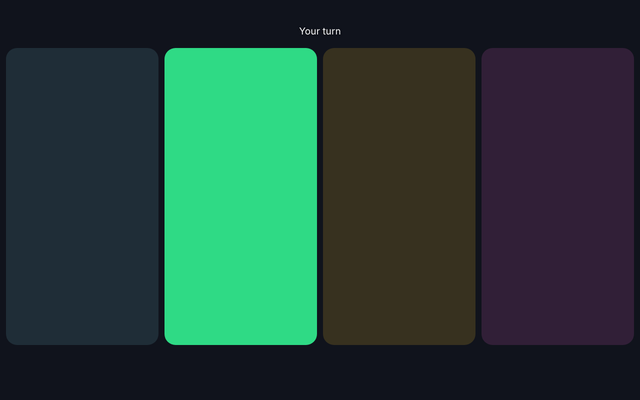
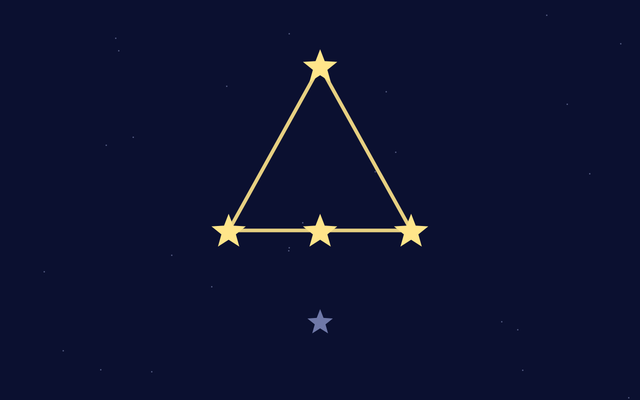
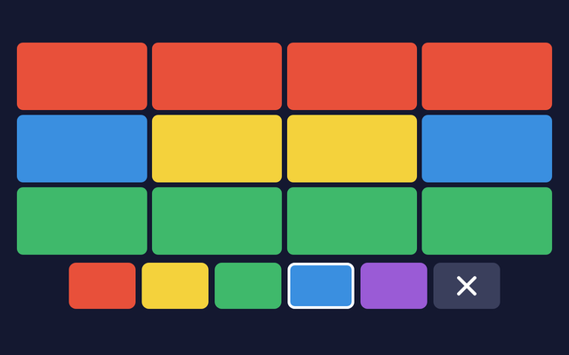

<picture>
  <source media="(prefers-color-scheme: dark)" srcset="assets/logo-dark.png">
  
</picture>

Free games built for disabled children to interact with a screen through movement. Any movement in front of the camera brings up simple colour and sound.

**Play:** https://wiggleplay.org/

*Silent demo of Musical Colours, captured with a simulated camera.*

## Games

| | Game | What happens |
| --- | --- | --- |
|  | [**Musical Colours**](https://wiggleplay.org/games/musical-colours/) | Any movement fills the screen with slowly blending colour and soft music. |
|  | [**Surprise Friends**](https://wiggleplay.org/games/surprise-friends/) | Any movement brings a new animal friend onto the screen with its own little tune. |
|  | [**Balloon Pop**](https://wiggleplay.org/games/balloon-pop/) | Balloons float up the screen. Move to pop them, with a real pop and a shower of pieces. |
|  | [**Music Wall**](https://wiggleplay.org/games/music-wall/) | Move on one side of the screen to light that pad and play its note. |
|  | [**Walking Animals**](https://wiggleplay.org/games/walking-animals/) | Look left or right and a friendly animal walks that way. Close your eyes and it falls asleep. |
|  | [**Spot the Odd One**](https://wiggleplay.org/games/odd-one/) | Find the animal that is different from the others. |
|  | [**Shape Fit**](https://wiggleplay.org/games/shape-fit/) | Pick the hole the shape fits and watch it glide into place. |
|  | [**How Many?**](https://wiggleplay.org/games/how-many/) | Count the animals, then pick the matching number. |
|  | [**Find the Pair**](https://wiggleplay.org/games/find-the-pair/) | Turn over cards to find two animals the same. |
|  | [**Copy the Tune**](https://wiggleplay.org/games/copy-the-tune/) | Watch the pads light up, then copy the tune. It grows one note at a time. |
|  | [**Star Pictures**](https://wiggleplay.org/games/star-pictures/) | Light the stars in any order to draw a picture in the sky. |
|  | [**Colour Squares**](https://wiggleplay.org/games/colour-squares/) | Pick a colour and fill the squares to make your own picture. |

More to come.

## Sources

Ten of these games are our own takes on ideas from the free switch-accessible games at [CerebralPalsyCenter.com](https://www.cerebralpalsycenter.com/games/): Surprise Friends, Balloon Pop, Music Wall and the seven choosing games from Spot the Odd One to Colour Squares. Each is rebuilt with new code, art and sound so it can also be played by movement through the camera.

## Collaborate

Want to work on this together? That would be great. Email [moeghaf@gmail.com](mailto:moeghaf@gmail.com) or [open an issue](https://github.com/moeghaf/WigglePlay/issues) to say hello, or to ask for a specific game to be built for your child.

You could even try vibe coding a game yourself. It is very easy to do:

1. Copy `games/surprise-friends/` to a new folder under `games/`. It is the shortest game.
2. Ask an AI coding assistant to change what happens on movement.
3. Add your game to the list on `index.html` and in this README.

`shared/kit.js` gives every game its settings screen, camera, timer and sound. `shared/motion.js` detects movement and `shared/face.js` tracks head turns, eye direction and eye closing.

## Gentle and private

- Colour and sound only fade and blend. Nothing flashes.
- The adult sets the limits for brightness, volume and session length.
- Video stays on the device. Nothing is recorded or sent.

These are toys for supervised play, not medical devices.
